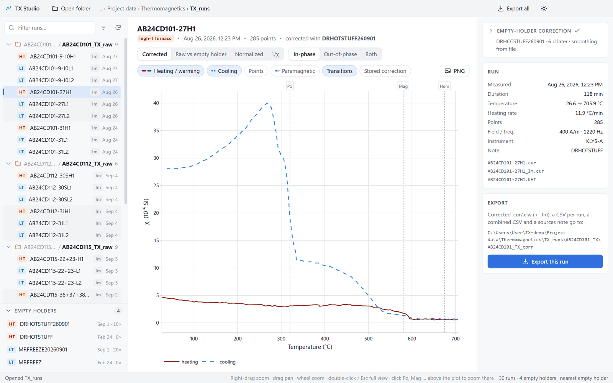
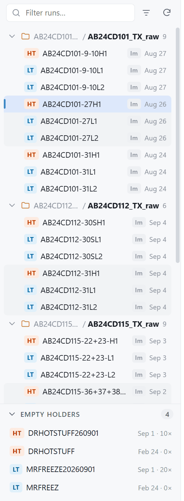
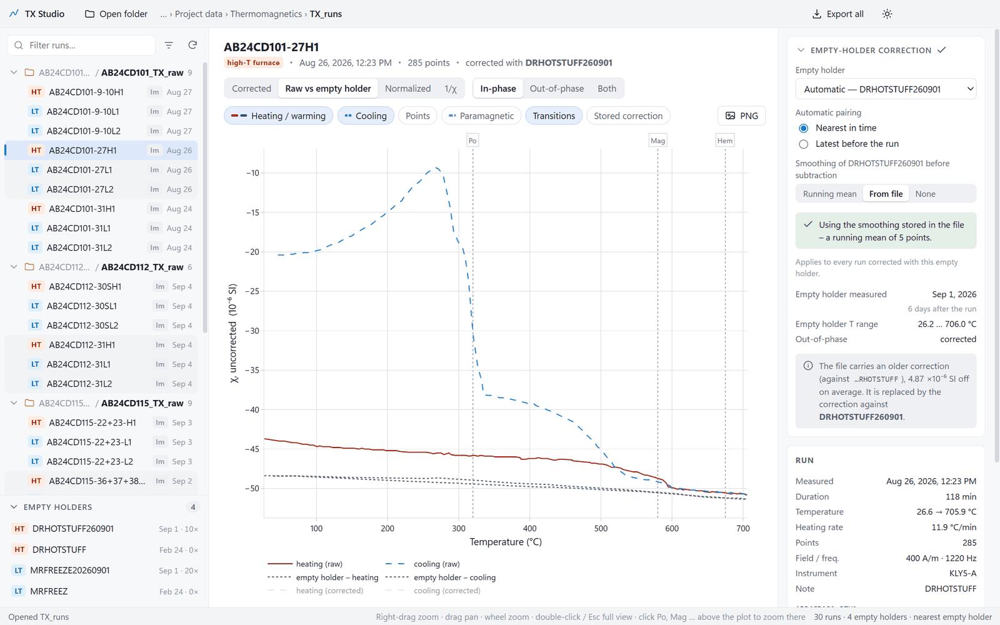
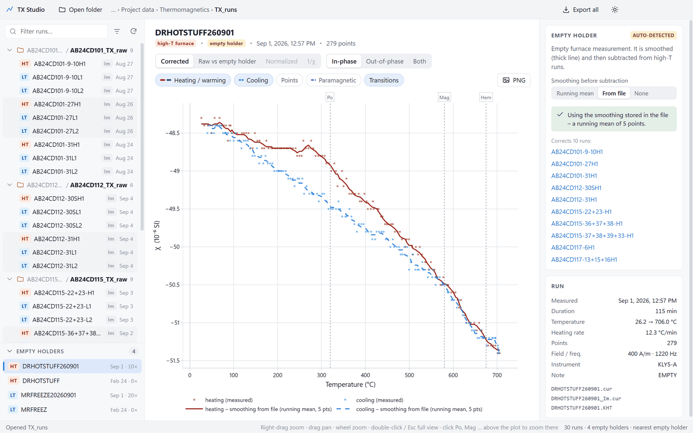
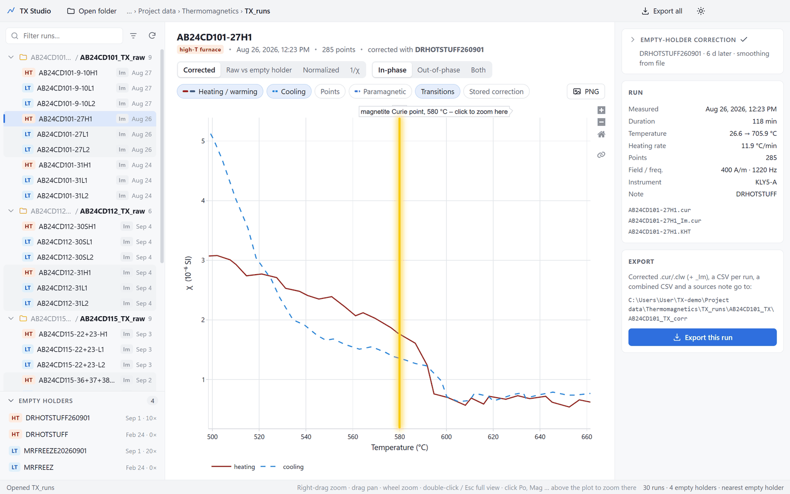
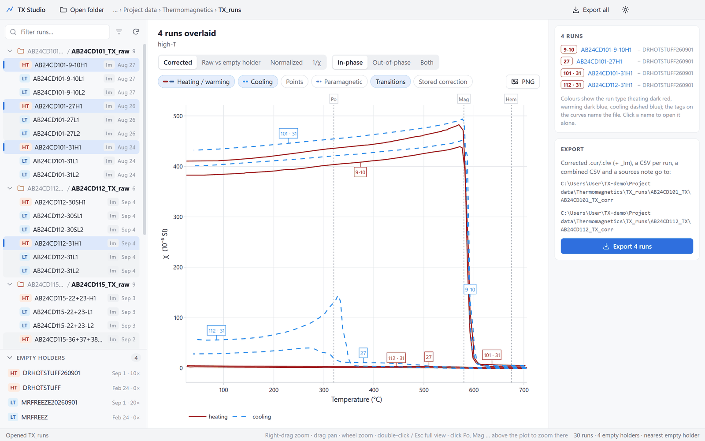
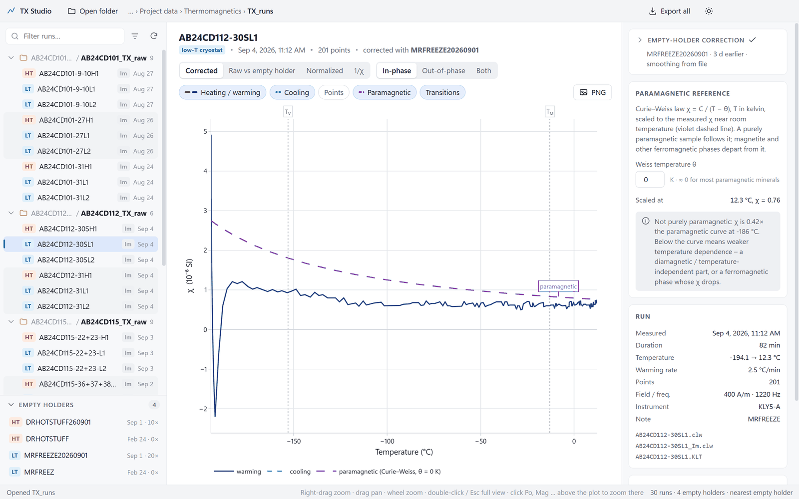

# TX Studio

A desktop viewer for thermomagnetic (temperature–susceptibility, "TX") runs measured on
KLY5 / MFK Kappabridges with a furnace or cryostat: browse a folder of `.cur` / `.clw`
runs, look at the curves, and correct every run for the empty holder automatically.

<picture>
  <source media="(prefers-color-scheme: dark)" srcset="docs/screenshots/overview-dark.png">
  
</picture>

## Install on a Windows PC

1. Download **[TX-Studio-win32-x64.zip](https://github.com/egorsann/TX-studio/releases/latest/download/TX-Studio-win32-x64.zip)**
   (under 1 MB; or pick a version under [Releases](https://github.com/egorsann/TX-studio/releases)).
2. Unzip it (right-click → *Extract All…*).
3. Double-click **`Install TX Studio.cmd`** in the unzipped folder.

That's it: TX Studio is copied to `%LOCALAPPDATA%\Programs\TX Studio`, gets a
**TX Studio** shortcut in the Start Menu and on the Desktop, and starts. No admin rights.

* Needs **Windows 10 or 11, 64-bit** — nothing else. The app shows its window through the
  Microsoft Edge WebView2 runtime that is part of Windows 11 and current Windows 10 (if a PC
  lacks it, the app offers the download).
* If Windows shows *"Windows protected your PC"*: **More info → Run anyway** (the app
  isn't code-signed). Happens once.
* **Update:** the app checks GitHub for a newer release (at most every 6 hours) and shows a
  small *Update* pill in the top bar; it opens the download page — run `Install TX Studio.cmd`
  from the new zip.
* **Uninstall:** `Uninstall TX Studio.cmd` in `%LOCALAPPDATA%\Programs\TX Studio`.
* Don't want to install? Double-click `TX Studio.exe` in the unzipped folder instead.
* Settings (last folder, choices) are kept per user in `%APPDATA%\TX Studio`.

## Features

### Folder view



Open a folder (button, `Ctrl+O`, or drop a folder / a `.cur` file on the window) and the
sidebar shows its thermomagnetic runs — `HT` = high-T furnace (`.cur`), `LT` = low-T
cryostat (`.clw`) — with the measurement date from the instrument record (`.KHT`/`.KLT`).

* An `_Im` file — the out-of-phase ("imaginary", χ″) susceptibility — is merged into its run
  (`Im` badge); the *Out-of-phase* and *Both* views plot it.
* Pieces are listed alphabetically; the runs of one piece appear in the order they were
  measured — `27L1`, `27H1`, `27L2` — and share a faint background band, like Finder's
  row stripes. Runs whose names don't follow the scheme are grouped by the day they were
  measured; the **Empty holders** panel is banded by measuring day too.
* **Notes** classify each run at a glance: type them in the inspector, items separated by
  `;` (or click a tag — paramagnetic, magnetite, hematite, pyrrhotite, Verwey, Morin, …).
  They show faded after the run's name; **Alt + hover** lists them one item per line. The
  filter box searches them too.
* **Links:** in that Alt panel, Alt + click an item, then click the point of the curve it
  belongs to. Afterwards Alt + click on the item zooms there (Alt + Shift + click links it
  anew, × removes the link). They are kept in a small `<specimen>_notes.json` beside the
  raw folder (`AB24CD101_TX/AB24CD101_TX_notes.json`), so they travel with the data.
* The folder that holds the runs is bold; single-child folders are compacted
  (`AB24CD101_TX / AB24CD101_TX_raw`); exported `_corr` folders are hidden (filter menu).
* ↑/↓ flips through runs, Ctrl/Shift-click overlays several, type to filter.
* The **Empty holders** panel lists every empty-holder run found, how many runs each
  corrects, and the last folder is reopened next time.

File names are expected to start with the specimen ID and end with the run code
(`H1`, `L1`, `L2`, …), e.g. `AB24CD101-27H1.cur`.

**New data:** when a folder is opened (or new folders appear in it), TX Studio offers —
one Yes / No pop-up each, showing the paths — to bring it into the lab's layout:

* an empty-holder folder in `holder_corrections` gets the name
  `TX_holder_correction_YYYYMMDD`, and runs not named like the instrument names them
  become `DRHOTSTUFF<YYMMDD>` / `MRFREEZE<YYYYMMDD>` (so `cureval_correct.py` finds them too);
* a specimen folder with its runs lying directly in it gets them moved into
  `<SPEC>_TX_raw`, with an empty `<SPEC>_TX_corr` next to it;
* a run whose specimen ID is the folder's with letters missing (`AB24D101-27L1` in
  `AB24CD101_TX`) is renamed.

Nothing is deleted or overwritten; "No" isn't asked again. Empty holders are recognised in
any folder inside `holder_corrections`, and one without `.KHT`/`.KLT` record takes its
measuring date from its name (`20261013`, `261013`), so it's paired by time like the others.

<br clear="right">

### Automatic empty-holder correction



No manual "smooth the empty curve, open it, subtract":

1. Empty-holder runs are recognised by the instrument record (`Note = EMPTY`), by name
   (`*HOTSTUFF*`, `*FREEZ*`, `*FROSTY*`, `empty`, `dry run`), or by sitting in a `*holder*`
   folder. The opened folder *and up to three levels above it* are searched, so opening a
   single specimen still finds `holder_corrections/`. Right-click any run to mark/unmark it.
2. Each run is paired with the empty-holder run of the same kind measured **nearest in time**
   (or the latest one before it), or one you pick.
3. The empty holder is smoothed and subtracted (see *The correction* below). *Raw vs empty
   holder* shows what is subtracted.

The correction card stays collapsed to one line — holder · time gap · smoothing — with a
green check, or an amber mark when something needs a look (no holder, holder more than
30 days away, no smoothing). A stretch of the run beyond the empty holder's temperature range
is only a notice (gray, muted triangle): its **OK** switch stops it flagging the card, kept in
the run's `_notes.json` for that empty holder.



Select an empty-holder run to choose how it is smoothed before it is used: a **running
mean** over N points, the smoothing already stored in the file (**From file**), or
**None**. The plot previews it; the choice applies to every run corrected with that holder.

### Transition labels: click to zoom



Po, Mag, Hem (pyrrhotite, magnetite, hematite) for high-T runs and T<sub>V</sub>, T<sub>M</sub>
(Verwey, Morin) for low-T runs sit as small labels above the plot. Hovering one shows faintly
where its line is; clicking zooms onto the data there — the line flashes yellow and its
temperature stays in yellow on the axis until you move the plot. Double-click or Esc returns
to the full curve.

* **Hopkinson peaks** (χ peaking just below the pyrrhotite or magnetite Curie point —
  clearest in the out-of-phase curve) get a small label at the tip, naming the mineral; in
  the in-phase view, a peak only χ″ shows is marked *χ″ Hopkinson* (E switches to it).
* Zoomed in, arrows at the plot edges name the next transition beyond the view (Po, Mag,
  Hem …), or a steep χ drop / rise or the curve leaving the paramagnetic hyperbola where no
  transition is; click to jump there. Low-T plots always show **‹ Besnus 30–34 K** at the cold
  edge — pyrrhotite's transition lies below what the cryostat reaches.
* **Alt** held over the plot: a faint line at the mouse reads the temperature and every
  curve's χ and measuring time there, and the measurement points show.
* **Annotations:** Alt + click a point opens a small text box (it stays while Alt is held;
  click into it, type, Enter). The label is placed clear of the curves with a thin line to
  its point; drag it anywhere, Alt + click it to edit or delete. Annotations and links are
  kept in the run's `_notes.json`.

**Mouse:** right-drag = zoom box (a flat box zooms temperature only, a narrow one χ only),
left- or middle-drag = pan, wheel = zoom. Views: corrected, raw vs empty holder,
normalised, 1/χ — in-phase, out-of-phase (button outlined red) or both (χ″ on the right
axis, both zero lines at the same height); **E** switches in-phase ↔ out-of-phase,
Shift+E both, and switching keeps the zoom. Heating is dark red, low-T warming dark blue,
cooling a dashed brighter blue; *Points* shows the measurements. *PNG* saves a
white-background figure.

### Overlays



Overlaid runs keep the run-type colours; every curve gets a small tag in its own colour
naming the file by the part between specimen ID and run code (`AB24CD112-30SH1` → `30S`),
made unique only where needed (`27 L1` / `27 L2`, `101 · 31` / `112 · 31`).

### Paramagnetic fit



The *Paramagnetic* toggle fits χ = χ₀ + C / (T − θ) (T in kelvin; Hrouda's hyperbola method)
where the curve is paramagnetic on top of a temperature-independent χ₀, and reports the
**paramagnetic share** of χ near room temperature (C / (T − θ) over the measured χ, with its
uncertainty). Only for **L1** and the **heating of H1**: after heating, magnetite has formed.

* The heating curve is followed from its start while the hyperbola fitted so far also
  predicts the next 8 °C; where χ stays off it, the inspector says at which temperature the
  curve **leaves the hyperbola** and which way — rising above it is typically a mineral
  forming (pyrite, siderite or clays → magnetite), falling below a Curie point. A ring marks
  the spot on the plot.
* The inspector lists every stretch that follows a hyperbola (for low-T runs also the whole
  warming branch). **Hover** one to shade it on the plot, **click** it to use it and zoom there.
* The fit is drawn solid over the fitted stretch and dashed where extrapolated, labelled
  "para 61 %"; θ is adjustable (default 0 K = Curie law). In overlays each run has its own fit.
* **Mineral model:** the paramagnetic minerals of a reference rock — a porphyry
  monzogranite by default (7 % biotite, 3 % hornblende in quartz + feldspars) — as a fixed
  dotted curve in absolute units (×10⁻⁶ SI, Curie law). It is never fitted to the run: a
  sample with lots of fresh hornblende and biotite reaches its level *and* its steep rise to
  low temperature, a flat curve does not. The slider (or *Lay onto curve*) only shifts it up
  or down, to compare slopes; with a hyperbola fit the card also gives the fitted C as a
  percentage of the model's. Mode, mean χ (from typical FeO contents) and θ are editable.
  Absolute values compare only when the run's χ is normalised to the specimen's real volume.

### Export

`Ctrl+E` (this run), `Ctrl+Shift+E` / *Export all* write, next to the raw folder
(`X_raw/` → `X_corr/`, otherwise `<folder>/<folder>_corr/`): corrected `.cur`/`.clw`
(+ `_Im`) in the original format, a CSV per run (`piece, run, mode, temp_C, time_s, segment,
chi_in_1e6SI, chi_in_norm, chi_out_1e6SI, chi_raw_1e6SI, holder_1e6SI`), a combined CSV and
a `_sources.txt` noting which empty holder (and smoothing) corrected what. The app asks
before replacing existing files and refuses to write anywhere but a `*_corr` folder (and
the `*_notes.json` notes files), so raw data can't be overwritten.

## The correction

* **Smoothing** — a centred *running mean* over N points (default 5; the first/last N/2
  points copied from the nearest full window, rounded to 0.01), the smoothing stored in the
  file's CSUSC column (the default when the file has one), or none (warned against).
* **Subtraction** — sample and empty holder are split into heating / cooling at their
  temperature maximum. For each sample point the smoothed empty holder is looked up on the
  same branch: below the branch's first point or beyond its last point the end value is
  used, otherwise the *first pair in measurement order* that brackets the temperature
  (rising pairs when heating, falling when cooling) is interpolated linearly, in single
  precision. `CSUSC = TSUSC − that value`.
* **Normalisation** — `NSUSC = CSUSC / max(CSUSC)` (signed maximum).
* The written `.cur`/`.clw` keeps every other column as it was, zeroes BULKS (it derives
  from the old CSUSC) and puts the empty holder's name in the header's EMPTY field.

## Development

Needs Node.js 22+ on Windows.

```
npm install
npm run host            # build the Windows app and run it on the source tree
npm test                # parser / smoothing / pairing / correction / hyperbola tests
npm run pack            # dist\TX-Studio-win32-x64.zip with installer
npm start               # alternative: run the UI in Electron (development only)
node test/check_run.js <folder> <specimen prefix>   # corrections of one specimen vs stored / earlier CSVs
node test/para_fit.js <folder> [<run prefix> ...]    # paramagnetic stretches of every run
```

The app is a ~40 KB Windows host (`host/TXStudio.cs`) that shows the web UI (`src/`) in the
system's WebView2 runtime. It is compiled with the C# compiler that ships with .NET
Framework 4.8 — no SDK to install; the three WebView2 SDK DLLs are fetched from NuGet
(hash-checked) on the first build. `src/host-bridge.js` gives the UI file access, dialogs
and settings through the host; Electron's `main.js` / `preload.js` do the same for `npm start`.

Real-data tests run when `TX_TEST_DATA` (or a one-line `test/data-path.local`) points at a
folder with `holder_corrections/` and `<SPEC>_TX/<SPEC>_TX_raw/` runs.

`src/lib/curlib.js` holds all file handling and correction maths; `src/app.js` is the UI;
`scripts/` the build, packaging and installer. Screenshots in `docs/screenshots` use made-up
specimen IDs.

To publish a new version: bump `version` in `package.json`, `npm run pack`, then
`gh release create vX.Y.Z dist/TX-Studio-win32-x64.zip`.

## License

MIT
